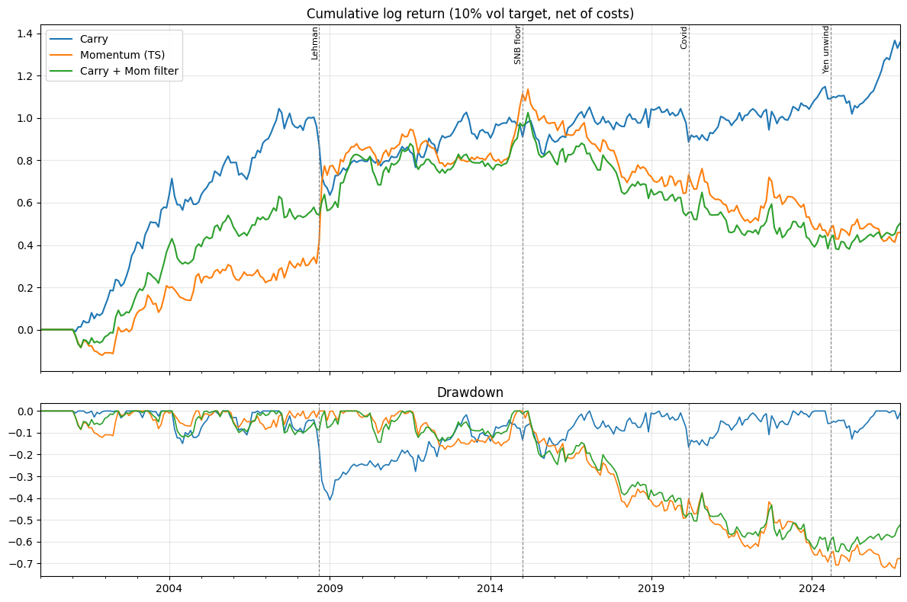

# FX Carry Crash Insurance

**Does a momentum filter protect the currency carry trade from crashes? Evidence from G10 currencies, 2000–2026**

[](https://colab.research.google.com/github/gabsmm18/fx-carry-crash-insurance/blob/main/notebooks/carry_momentum_fx.ipynb)
[](https://github.com/gabsmm18/fx-carry-crash-insurance/actions/workflows/monthly_signal.yml)

## Abstract

The currency carry trade earns a positive average return but is exposed to sudden, severe losses during periods of market stress. This project tests whether a 3-month time-series momentum filter, which closes carry positions whose recent performance contradicts the carry signal, mitigates this crash risk without sacrificing the carry premium. Using G10 currencies over January 2000 – October 2026, net of transaction costs, the filter reduces the skewness of monthly returns from −0.81 to −0.10 and improves returns in six of seven major crisis months (October 2008: −11.2% to +3.6%). However, it lowers the Sharpe ratio from 0.40 to 0.19 and does not reduce the maximum drawdown. The result holds in 10 of 12 parameter specifications. The filter therefore acts as costly crash insurance rather than as a source of alpha.



*Figure 1. Cumulative log returns (top) and drawdowns (bottom) of the three strategies, scaled to a 10% annual volatility target, net of transaction costs.*

## 1. Motivation

Under uncovered interest parity (UIP), the expected depreciation of a currency equals its interest rate differential against the investor's home currency:

$$E_t[\Delta \ln S_{t+1}] = -(i^*_t - i_t)$$

where $S$ is the exchange rate in USD per unit of foreign currency, $i^*$ the foreign interest rate and $i$ the US interest rate. If UIP held, borrowing in low-yielding currencies to invest in high-yielding ones would have zero expected return. Empirically, high-yielding currencies depreciate by less than the differential implies, and often appreciate (Fama, 1984). This forward premium puzzle is the source of the carry trade's positive average return.

The literature interprets this return largely as compensation for risk. Carry returns are negatively skewed and concentrated losses occur during episodes of global deleveraging (Brunnermeier, Nagel & Pedersen, 2008), carry performs poorly when global FX volatility rises (Menkhoff et al., 2012a), and the cross-section of currency returns is largely explained by a common carry factor (Lustig, Roussanov & Verdelhan, 2011). Separately, currencies exhibit time-series momentum (Menkhoff et al., 2012b). Because carry unwinds often unfold over several months, a momentum signal could in principle identify them early. This project tests that conjecture.

## 2. Data and Methodology

**Data.** Daily exchange rates from the Federal Reserve H.10 release and monthly 3-month interbank rates from the OECD Main Economic Indicators, both retrieved from FRED. Exchange rates are sampled at month-end. The universe comprises nine G10 currencies against the US dollar: EUR, GBP, JPY, CHF, AUD, NZD, CAD, NOK and SEK.

**Excess returns.** The monthly excess return from holding currency *k* against the USD is

$$xr_{k,t} = \ln\frac{S_{k,t}}{S_{k,t-1}} + \frac{i^*_{k,t-1} - i_{t-1}}{12}$$

which approximates the return on a rolled one-month forward contract under covered interest parity.

**Strategies.** All portfolios are rebalanced monthly. Signals are formed with information available at the end of month *t* and applied to returns in month *t+1*.

| Strategy | Construction |
|---|---|
| Carry | Rank currencies by interest rate differential; long the top three and short the bottom three, with weights of ±1/3. The portfolio is dollar-neutral. |
| Time-series momentum | Long each currency with a positive 3-month cumulative excess return, short otherwise; equal weights. |
| Carry + momentum filter | Carry portfolio, with a long (short) position set to zero when its 3-month excess return is negative (positive). |

**Costs and risk scaling.** Transaction costs are 3 basis points per unit of turnover. Results are reported both at raw exposure and at a 10% ex-ante volatility target, based on 24-month realised volatility with leverage capped at 3×. The baseline parameters (three currencies per leg, 3-month lookback) were fixed before the results were examined.

## 3. Results

**Table 1. Performance, January 2000 – October 2026, net of costs**

| | Carry | TS Momentum | Carry + Filter |
|---|---:|---:|---:|
| Annual return | 2.8% | 0.2% | 1.4% |
| Annual volatility | 7.0% | 6.2% | 7.2% |
| Sharpe ratio | 0.40 | 0.04 | 0.19 |
| Sharpe ratio (10% volatility target) | 0.49 | 0.15 | 0.19 |
| Skewness | −0.81 | 0.54 | −0.10 |
| Worst month | −11.2% | −5.8% | −8.0% |
| Maximum drawdown | −33% | −40% | −37% |
| Share of positive months | 58% | 48% | 52% |
| Average monthly turnover | 0.10 | 0.52 | 0.55 |

*Raw exposure unless stated. Maximum drawdown is computed on cumulative log returns. The carry Sharpe ratio has a t-statistic of approximately 2.1.*

**Table 2. Monthly returns in crisis episodes**

| Month | Episode | Carry | TS Momentum | Carry + Filter |
|---|---|---:|---:|---:|
| Oct 2008 | Post-Lehman market turmoil | −11.2% | 9.6% | 3.6% |
| Nov 2008 | Global deleveraging | −3.6% | 3.0% | 2.0% |
| Aug 2011 | Euro area debt crisis, US downgrade | −0.6% | −0.3% | −1.2% |
| Jan 2015 | SNB removes the EUR/CHF floor | −3.5% | 1.9% | −0.7% |
| Mar 2020 | COVID-19 dollar funding stress | −5.7% | 3.4% | 0.9% |
| Sep 2022 | US dollar appreciation | −4.6% | 5.2% | 2.9% |
| Aug 2024 | Yen carry unwind | 0.0% | 2.5% | 3.3% |

The filter outperforms carry in six of the seven episodes and delivers a positive return in five. Ahead of October 2008 it had already reduced gross exposure by half. It offers limited protection against discontinuous shocks without a preceding trend, such as the Swiss National Bank decision of January 2015.

**Table 3. Sharpe ratio by sub-period**

| Period | Carry | TS Momentum | Carry + Filter |
|---|---:|---:|---:|
| 2000–2007 | 0.95 | 0.25 | 0.54 |
| 2008–2015 | 0.03 | 0.43 | 0.37 |
| 2016–2026 | 0.42 | −0.50 | −0.27 |

**Robustness.** Across 2, 3 and 4 currencies per leg and lookback windows of 1, 3, 6 and 12 months, the filter lowers the Sharpe ratio relative to pure carry in 10 of 12 specifications.

## 4. Discussion

First, the carry strategy displays the properties documented in the literature: a positive, marginally significant premium combined with pronounced negative skewness, consistent with a crash-risk interpretation.

Second, the filter achieves its intended objective of reducing crash exposure, but at a substantial cost. In periods without persistent trends it exits positions that subsequently recover and re-enters late. These whipsaw losses, together with turnover nearly six times higher than pure carry, produce the gradual decline visible in Figure 1 after 2015. As a result, the filter does not reduce the maximum drawdown: it replaces a sharp loss with a prolonged one.

Third, the filtered strategy largely inherits the behaviour of momentum. It adds value only during 2008–2015, when momentum itself performed well, and underperforms afterwards. Because the filter removes positions from one side of the portfolio independently of the other, it also breaks dollar-neutrality and introduces an unintended directional exposure to the US dollar. This explains why its volatility does not decline despite holding fewer positions.

Finally, momentum generates its strongest returns precisely when carry experiences its largest losses. This negative dependence in crisis periods suggests that combining the two strategies as separate return sources, in the spirit of Asness, Moskowitz & Pedersen (2013), may be a more effective use of the momentum signal than using it as a conditioning filter. This is left for further work.

## 5. Limitations

- **Interest rate data.** OECD 3-month interbank rates are monthly averages and serve as a proxy for forward-implied rates; deviations from covered interest parity are not modelled. The EUR and GBP series on FRED end in January 2026, so these currencies are excluded from the most recent months.
- **Cross-section.** Nine currencies with three per leg form a concentrated portfolio. Academic studies typically use 30–50 currencies, including emerging markets. The US dollar is not part of the ranking.
- **Statistical inference.** Sharpe ratio estimates have a standard error of approximately 0.2 over this sample. Differences between strategies have not been formally tested.
- **Implementation.** Transaction costs of 3 basis points reflect institutional execution. Retail implementation would face wider spreads and lower realised carry.

## 6. Repository Structure

```
notebooks/carry_momentum_fx.ipynb     Research notebook: theory, backtest, crisis analysis, robustness
src/strategy.py                       Data retrieval, signal construction, backtest and performance metrics
src/live_signal.py                    Monthly signal generation and optional Interactive Brokers paper-trading rebalancing
.github/workflows/monthly_signal.yml  Scheduled workflow that recomputes the signal on the 8th of each month
figures/                              Figures used in this document
requirements.txt                      Python dependencies
```

The scheduled workflow stores current target positions in `signals/latest.json` and the full history in `signals/history.csv`.

## 7. Reproduction

A free FRED API key is required ([fredaccount.stlouisfed.org/apikeys](https://fredaccount.stlouisfed.org/apikeys)).

**Google Colab.** Open the notebook via the badge above, store the key as a Colab secret named `FRED_API_KEY`, and run all cells.

**Local environment.**
```bash
pip install -r requirements.txt
export FRED_API_KEY=your_key
python src/live_signal.py                               # compute the current signal
python src/live_signal.py --broker ib --capital 100000  # dry run against an IBKR paper account
```

**Scheduled signal.** Add `FRED_API_KEY` as a repository secret under *Settings → Secrets and variables → Actions*.

Orders are submitted only to a paper trading account and only when the `--execute` flag is passed explicitly.

## 8. Further Work

- Combination of carry and momentum as a diversified portfolio
- Replacement of the EUR and GBP rate series (€STR, SONIA)
- Bootstrap inference on Sharpe ratio differences
- Extension of the universe to emerging-market currencies

## References

Asness, C., Moskowitz, T. & Pedersen, L. (2013). Value and momentum everywhere. *Journal of Finance*, 68(3), 929–985.

Brunnermeier, M., Nagel, S. & Pedersen, L. (2008). Carry trades and currency crashes. *NBER Macroeconomics Annual*, 23, 313–347.

Fama, E. (1984). Forward and spot exchange rates. *Journal of Monetary Economics*, 14(3), 319–338.

Lustig, H., Roussanov, N. & Verdelhan, A. (2011). Common risk factors in currency markets. *Review of Financial Studies*, 24(11), 3731–3777.

Menkhoff, L., Sarno, L., Schmeling, M. & Schrimpf, A. (2012a). Carry trades and global foreign exchange volatility. *Journal of Finance*, 67(2), 681–718.

Menkhoff, L., Sarno, L., Schmeling, M. & Schrimpf, A. (2012b). Currency momentum strategies. *Journal of Financial Economics*, 106(3), 660–684.

---

Mattia Mariani, MSc Applied Economics and Finance, Copenhagen Business School

This repository is for research and educational purposes only and does not constitute investment advice.
